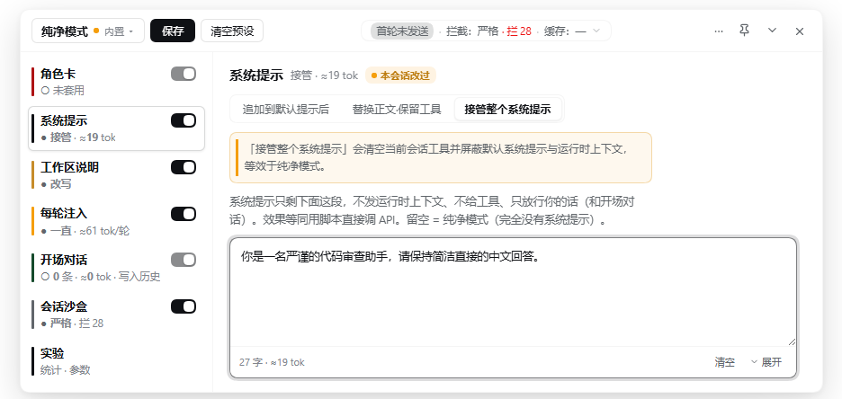
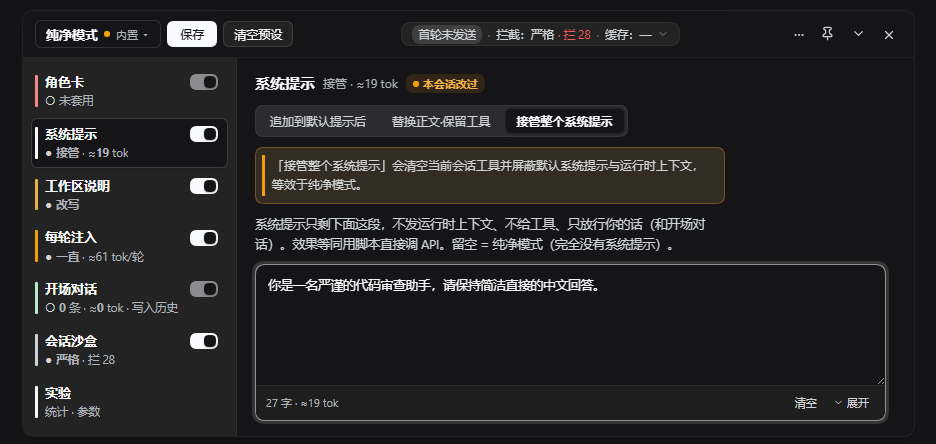

# dsh-prefill-plugin

DSH（DeepSeek Harness）Web 端「预填装」插件：在会话开始前为模型准备好系统提示、开场对话、每轮注入提醒、角色卡与会话沙盒；所有功能集中在同一张弹出卡片里，**每一项都可单独停用并保留内容**。

> 适配 DSH `0.2.x`（`package.json` 已覆盖 `0.1.7-rc.2` 至 `0.2.2-rc.5`）· 当前版本 **[v0.22.0](https://github.com/NekoDD-wow/dsh-prefill-plugin/releases)** · [更新日志](CHANGELOG.md)
>
> **状态说明**：实验功能「思考前缀 + 工具代理（`reasoning-prefix.js`）」已于 2026-11-21 冻结（保留可用、默认关闭、不再新增功能或适配），详见 [思考前缀文档](docs/reasoning-prefix.md)。



<sub>点击输入框下方的「预填装」胶囊弹出卡片：左栏分项开关、右栏编辑当前节；头部三区为「当前预设 ▾ + 保存 + 清空预设｜状态胶囊（状态胶囊显示「首轮未发送 / 已锁定」· 拦截档位 · 缓存命中）｜⋯ / 钉住 / 收起 / 关闭」。</sub>

<details>
<summary>查看深色主题界面</summary>



</details>

## 安装

```bash
git clone https://github.com/NekoDD-wow/dsh-prefill-plugin.git
dsh plugin --profile web add /clone下来的绝对路径/dsh-prefill-plugin
```

插件位于仓库根目录（Windows / WSL 路径均可），安装后**重启** `dsh web` 即可生效。

进入会话后，输入框工具栏会出现两颗胶囊（有非默认配置时，会话右上角顶栏也会出现状态角标）：

| 入口 | 作用 |
| :--- | :--- |
| **预填装** | 打开 / 收起预填装卡片；显示当前预设名 + 状态点 + `已配置 N/8` |
| **纯净 / 接管** | 一键切换纯净模式（清空系统提示、运行时上下文与工具）；有自定义系统提示时显示「接管·开」 |


> 旧版 `pure-preset` 已不再需要，纯净态由本插件完全接管。

## 核心功能速览

| 模块 | 说明 | 详细文档 |
| :--- | :--- | :--- |
| **预设与工作区保存** | 内置纯净模式、中文官方提示与 7 个人格预设；支持从当前会话截取并另存为预设、导入导出 | [功能详解](docs/guide.md#把会话存成预设从某一轮接着聊) |
| **系统提示** | 支持「追加 / 替换正文·保留工具 / 接管」三态，一体式编辑框实时统计字数与 token | [功能详解](docs/guide.md#系统提示与工作区说明) |
| **工作区说明** | 控制 `AGENTS.md` / `CLAUDE.md` 的发送方式：原样 / 关闭 / 改写，支持只读对照原文 | [功能详解](docs/guide.md#系统提示与工作区说明) |
| **每轮注入** | 工作台积木式管理首轮/每轮提醒；支持一直注入、前 N 轮与基于规则的**自动收放** | [每轮注入与实测](docs/thinking-and-cost.md) |
| **开场对话与手动注入** | 首轮前预填真实对话历史（含思维链）；首轮后支持单次插话注入、编辑与撤回 | [功能详解](docs/guide.md#首轮锁定与手动注入) |
| **角色卡 / 世界书 / 故事记忆** | 支持 SillyTavern V2/V3（JSON / PNG）导入导出、关键词触发世界书与定时前情摘要 | [角色卡指南](docs/character-cards.md) |
| **会话沙盒与注入审计** | 按来源包拦截或放行宿主注入，审计未登记注入（本会话阻断 / 全局记住） | [功能详解](docs/guide.md#改写注入与会话沙盒) |
| **全局设置页与用量缓存** | 左侧栏「预填装」提供 KPI 快筛、会话总览分组搜索、新会话默认与资源库管理 | [功能详解](docs/guide.md#全局设置页左侧栏预填装) |

## 三步上手

1. 点击输入框下方的 **「预填装」**，在头部 **「当前预设 ▾」** 中选择内置预设、我的预设或角色卡。
2. 在左栏按需编辑 **系统提示 / 每轮注入 / 开场对话**（改动停手自动保存，下一轮生效）；左侧每项开关**关掉仅停用，内容保留**。
3. 头部 **「保存」** 可覆写或另存预设，紧邻的 **「清空预设」** 可一键归位（几秒内可撤销）；**收起（⌄）** 会缩成角落标记，**×** 才关闭卡片。

## 文档导航

- [功能详解与进阶用法](docs/guide.md) — 卡片交互、首轮锁定、把会话存成预设、手动注入、全局设置页与文件结构
- [角色卡、世界书与故事记忆](docs/character-cards.md) — V2/V3 角色卡分层规则、世界书编辑与故事记忆摘要
- [每轮注入、自动收放与性能/缓存实测](docs/thinking-and-cost.md) — 思维链控制对比、自动收放规则、Token/缓存与 `v0.22.0` 网络开销
- [思考前缀（实验功能，已冻结）](docs/reasoning-prefix.md) — 冻结说明、必知事项、排查表与实验旋钮/结果行说明
- [变更记录（CHANGELOG）](CHANGELOG.md) — 各版本完整更新记录

## 开发与许可

```bash
npm test        # node --test tests/*.test.mjs（975 项 / 974 pass / 1 skip）
```

模块文件与本地数据路径（`state.json` / `.dsh-prefill/`）见 [文件与数据路径](docs/guide.md#文件与数据路径)。

MIT 许可，见 [LICENSE](LICENSE)。图标来自 [Lucide](https://lucide.dev)（ISC 许可），详见 [THIRD_PARTY_NOTICES.md](THIRD_PARTY_NOTICES.md)；`samples/cards/` 中社区角色卡署名见该目录说明。
