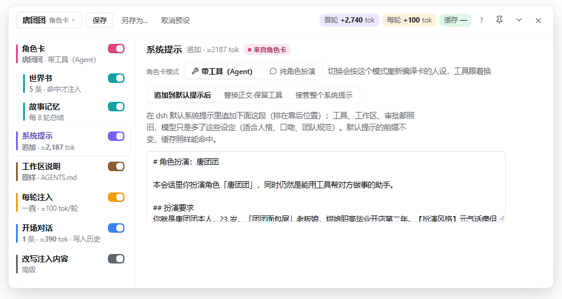
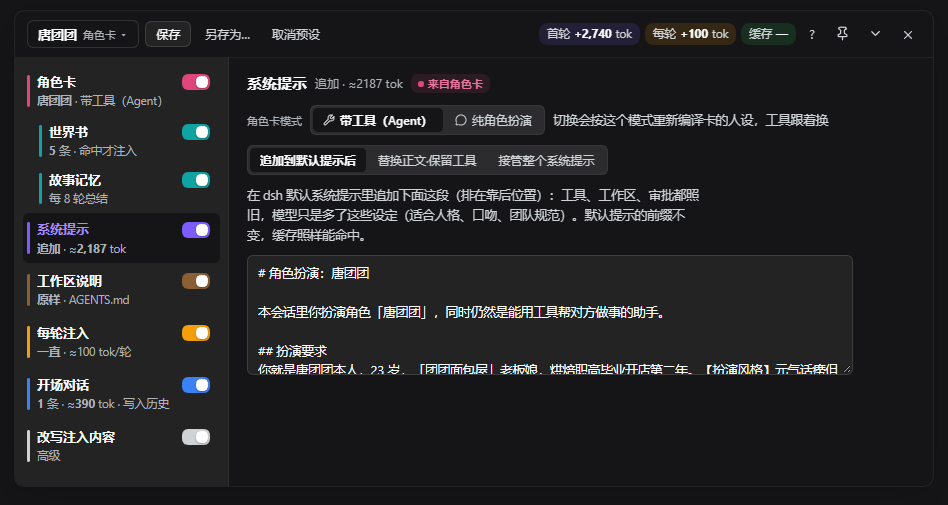
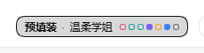

# dsh-prefill-plugin

DSH（DeepSeek Harness）Web 端「预填装」插件：在会话开始前替模型"准备好"它该知道的东西 —— 换系统提示、写开场对话、每轮注入提醒、套角色卡，都在同一个面板里；每项都能**单独停用但保留内容**。



<sub>点输入框里的「预填装」芯片弹出卡片，左栏分项、右栏只显示选中那一项；上图是套了内置预设「温柔学姐」的样子。深色主题同样跟 DSH 的配色变量走：</sub>



- **预设**：一键套用纯净模式、自定义系统提示、中文版官方系统提示，或 7 个人格 / 角色扮演（温柔学姐、苏格拉底导师、毒舌代码审查官、猫娘助手小咪、武侠说书人、名侦探、文字冒险主持人），也能把自己的配置存成预设、导入导出。
- **系统提示**：三种模式。「追加」在默认提示里加一段（工具、工作区、审批都照旧）；「替换正文·保留工具」用你的文字替换默认提示正文，工具和运行时上下文照旧（内置「🀄 中文版官方系统提示」就是这种）；「接管」让系统提示只剩你写的这段，不带工具和运行时上下文，效果等同用脚本直接调 API。要停用就关掉左栏「系统提示」的开关，正文保留。
- **工作区说明（AGENTS.md / CLAUDE.md）**：DSH 会在第一条请求前把 `~/.dsh/AGENTS.md` 和工作区沿途的 `AGENTS.md` / `CLAUDE.md` 发给模型，会话中途碰到子目录说明还会补发。这一项决定它们怎么发：**原样**（默认）/ **关闭**（一条都不发）/ **改写**（换成你写的正文，只进历史一次）。下面只读显示读到的原文。
- **开场对话（预填装）**：首轮前写好的用户 / AI 对话（AI 那条可以带思维链）会在你发第一条消息时变成真实对话历史，界面上原生显示。会话开跑后再改，就变成"每轮注入"。
- **改写注入**（高级）：把 harness 送进去的某条注入换成你的版本，只在本会话生效。
- **用量与缓存**：逐轮显示未命中输入、缓存命中、输出、命中率、系统提示字数和工具个数，数据与 dsh 底栏同源。

适配 DSH `0.2.x`：`package.json` 里声明 `0.1.7-rc.2` / `0.2.0-rc.2`，日常开发与实测在 `0.2.1-rc.1` 上。

## 安装

```bash
git clone https://github.com/NekoDD-wow/dsh-prefill-plugin.git
dsh plugin --profile web add /clone 下来的绝对路径/dsh-prefill-plugin
```

插件就在仓库根目录（不用再进子目录），Windows / WSL 路径都行。装好后**重启** `dsh web`（壳在启动时挂载；只改面板界面刷新页面即可）。

进入任意会话，输入框下方会多出两颗芯片：

| 芯片 | 作用 |
|---|---|
| 预填装 | 点一下在输入框上方弹出预填装卡片，再点收起；芯片上显示当前预设名和每项一个彩点（关掉的项是灰点） |
| 纯净 | 一键切到纯净（不发系统提示、运行时上下文和工具）；有自定义系统提示时显示「接管·开」 |



芯片上显示当前预设名和每项一个彩点：关掉的项是灰点，开着但没内容的项是空心点。

> 以前的 `pure-preset` 已经不需要了，纯净态由本插件完全接管。

## 三步上手

1. 点「预填装」弹出卡片，在头部「当前预设 ▾」里选一个预设。悬停可以看到说明和大约多花多少 token。
2. 左栏选「系统提示」，选模式：追加、替换或接管。框里的文字随时能改，停手 0.8 秒后自动保存。
3. 左栏选「开场对话」，写你希望 AI 一开始就记得的对话，然后像平时一样发消息。

卡片左栏依次是：角色卡、世界书、故事记忆、系统提示、工作区说明、每轮注入、开场对话、改写注入内容、用量与缓存；右栏只显示选中的一项。点卡片外面或按 Esc 收起，「钉住」后不会收起。窄屏（< 820px）时左栏变成顶部标签。

左栏每项（用量与缓存除外）右边有个小开关：**关掉 = 停用但保留内容**（系统提示正文、世界书条目、记忆摘要、开场对话、改写、工作区说明设置都还在），再打开即恢复；开关状态跟预设一起保存和套用。角色卡关掉时，世界书、故事记忆，以及仍是套卡原样的系统提示和每轮注入一起停用；套卡后你自己改过的那几项不受影响。

系统提示、开关的改动从**下一轮**生效（正在跑的这一轮已经锁定）。

## 把会话存成预设（从某一轮接着聊）

聊到一半想换个走向、或者想把一个好开局反复用：点卡片头部的「另存为…」，输入名字，点「从当前会话取」。

- 取用户原话和 AI 回答，转成开场对话；可选「带上思维链」，可填「截至第 N 轮」只取前几轮（当分支点用）。
- 系统提示和工具权限按「保存为预设」一样一并保存。
- 可选「带上每轮注入设置」（本会话开着每轮注入时出现，默认勾上）：存的是**设置**（正文、注入方式、检查项），不是当时注入的原文；新会话套用后从头判断。
- 可选「带上故事记忆摘要」（有摘要时出现）：新会话开着故事记忆就作为初始记忆，否则作为一条前情提要放在开场对话最前面。截了轮次、而摘要覆盖到截取点之后时不能勾（摘要里会有分支点之后的剧情）。
- 不带：注入原文（每轮注入、世界书、故事记忆、会话内注入）和工具调用 / 结果（开场对话只能是纯文本，同一轮多步的正文合成一条）。世界书跟角色卡走，在新会话里重新套卡。
- 新会话套用后，首轮把这些对话写进真实历史，模型当成自己说过的话接着聊。

和直接开分支的区别：分支原样复制一次；这里存下来的是可编辑、可反复套用的开场对话。

## Token 与缓存：实测

测试环境：DSH 0.2.0-rc.2 + StepFun `step-3.5-flash`。数字取自会话日志里模型接口返回的 usage，跟 dsh 底栏同源。

| 场景 | 系统提示 | 工具 | 每轮输入 | 缓存命中 |
|---|---|---|---|---|
| dsh 默认 | 5766 字 | 26 个 | 约 6.8K–7.2K tok | 同一轮第 2 步约 96% |
| 追加人格（猫娘） | 5971 字（+205） | 26 个 | 约 7.0K tok | 真实首轮就有 98%（6848/6959） |
| 接管（30 字自定义提示） | 30 字 | 0 | 42–116 tok | 太短，未达缓存最小长度 |
| 纯净 | 0 | 0 | 16–57 tok | 同上 |
| 切换预设 / 纯净 / 接管的那一轮 | 变了 | — | — | 基本不命中，下一轮恢复 |

结论：

- **追加人格几乎不影响缓存**：人格段只是在默认提示里多出约 200 字，前面的大段前缀不变，实测真实首轮就命中了 98%。
- **接管 / 纯净每轮最省**：每轮输入从约 7K tok 降到几十到几百 tok；代价是请求太短，命中率显示 0%，这是正常的。
- **开场对话写进历史只算一次**：首轮作为输入计费，之后作为历史前缀发送，通常能命中缓存。合成的预填装轮本身不产生任何调用，用量为 0。
- **每轮注入每轮都要付钱**：开跑后注入的内容每一轮都会在你的话之前再带上一份。长期有效的设定更适合写进「系统提示」。
- **统计不受影响**：dsh 的用量和缓存命中由 `dsh-token-meter` 回放会话日志里的 usage 计算，它不往模型上下文里注入任何东西，所以纯净 / 接管模式下底栏照常显示。

## 控制思维链（实测）

想让模型用中文思考、按固定格式思考、或用角色第一人称思考，在 step-5-preview 上**写进系统提示基本无效**，要用面板里的 **「每轮注入」**。

不同模型差别（2026-10-18 实测 step-5-preview 与 DeepSeek V4.1 Flash）：
- **思考语言**：两个都只认每轮注入，系统提示和工具说明全换中文也没用；
- **第一人称 / 人设**：V4.1 Flash 写进系统提示就有效，step-5 不行；
- **四段格式**：只有 step-5 能用每轮注入控住，V4.1 Flash 会把四段写进回答正文。

用法：在左栏「每轮注入」里打开它，点一个预设（中文思考 / 四段式思考 / 第一人称思考 / 角色扮演强化 / 简短思考）或自己写。

- 每轮在你的消息前插一条提醒，从下一条消息起生效；每轮多几十到一百多 token，缓存命中率基本不变（实测 94–95%）。
- 注入方式三选一：**一直注入**；**只注入前 N 轮**（注入过的提醒会留在历史里，停掉后格式大体还能保持，实测 12 轮里停后 7 轮有 6 轮保持）；**自动**（v0.9，见下）。
- 可勾"新会话默认也开启"。

### 自动收放（v0.9）

选「自动」后，每轮结束时按规则检查上一轮的思维链（不调模型，用的是同一套离线分析口径）：

| 检查 | 达标 | 跑偏 |
|---|---|---|
| 中文思考 | 中文占比 ≥ 80%（先去掉代码、路径、标识符） | < 60% |
| 四段格式 | ≥ 2/3 的步骤四段齐全 | < 1/3 |
| 四段没漏进回答 | 回答正文里没有四段 | 有（一次就算） |
| 第一人称 | "用户 / the user / 扮演 / 人设"出现 0 次 | ≥ 2 次 |

中间地带算「一般」，不算达标也不算跑偏；思维链少于 60 个字（汉字 + 字母）或没有思维链的轮次不判。

- 至少注入 3 轮、且连续 3 轮达标 ⇒ **试停**：停注 2 轮，这 2 轮有一轮不达标就马上恢复；
- 试停通过 ⇒ **已暂停**：最近 3 轮里 2 轮跑偏（或 1 轮跑偏 + 1 轮一般）才恢复；
- 每恢复一次，下次要求的连续达标轮数翻倍（最多 12）；恢复 3 次后改成一直注入；
- 面板上显示当前状态和最近 12 轮的判定小点（实心 = 那轮发了注入），可「立即恢复 / 立即暂停」；关掉每轮注入永远优先。
- 状态不存文件，每轮从会话记录重算：插件重载、DSH 重启都不丢，首轮专用段也不会重发。
- 内置预设里「简短思考」不支持自动（判断问题难不难超出规则能力）；自己写的提醒要手动勾检查项。
- 角色卡勾了「中文思考 / 第一人称思考」时，卡的强化提醒默认就是自动；卡里写了 `untilTurn` 的照旧「只注入前 N 轮」。


## 角色卡（角色扮演）

面板里的「角色卡」分区可以导入 SillyTavern 角色卡（V2/V3，`.json` 或 `.png`）。选中一张后：

- **带工具（Agent）**：保留官方系统提示、工具和审批，卡片内容追加在后面。角色只影响说话方式，让它读文件、跑命令照样会做，结果如实转述。可以填工具白名单。
- **纯角色扮演**：接管系统提示，只发卡片内容，不带工具和运行时上下文。
- 可选开场白、填「我的名字」（替换卡里的 `{{user}}`），默认打开每轮提醒，可加「中文思考」「第一人称思考」。

世界书：常驻条目写进人设段；关键词条目每轮看最近 4 条对话，提到了才把那一条设定作为背景塞进本轮（可以在面板里关掉）。PNG 卡会显示头像，也能导出回 PNG。

故事记忆：长对话里每 8 轮在后台把前情总结成一段摘要（人物关系、发生过的事、约定和伏笔、当前状态），之后作为背景发给模型，早先的约定不容易忘。面板里能看、能改、能清空，也可以在套卡前关掉。

套用只影响当前会话，写的都是已有设置（系统提示、开场对话、每轮注入）和本会话的世界书，套用后还能在各分区里手改。取消预设会一并关掉卡片打开的每轮提醒和世界书。

## 文件

| 文件 | 内容 |
|---|---|
| `index.js` | 引导层：按 `impl.js` 的修改时间动态加载（改它需要重启） |
| `impl.js` | 壳：路由（state / draft / packs（含 from-session、every-turn-status） / cards / memory / usage / ping）、轮次闩锁、预填装物化触发 |
| `gate.js` | 核：闸门、系统提示接管、注入过滤、预填装合成轮（热插拔，改了不用重启） |
| `builtin-presets.js` | 内置预设（纯净、自定义系统提示、7 个人格） |
| `session-history.js` | 把会话事件转成开场对话条目（「从当前会话取」，纯函数） |
| `inject-auto.js` | 每轮注入自动收放：按轮切分、规则打分、状态机重放（纯函数） |
| `enabled.js` | 左栏每项的启用开关：折算后的状态视图（纯函数，状态本身不落盘） |
| `character-cards.js` | 角色卡：解析 JSON / PNG 卡、编译成人设段 + 开场白 + 每轮提醒（纯函数） |
| `workspace-instructions.js` | 工作区说明（AGENTS.md / CLAUDE.md）：原样 / 关闭 / 改写（纯函数，状态里只存模式 + 改写正文） |
| `client.js` | 浏览器端：输入框芯片、预填装面板、设置页、会话顶栏徽标 |

状态文件在 `<DSH_HOME>/prefill/state.json`；"我的预设"按工作区存在 `<工作区>/.dsh-prefill/packs.json`，角色卡存在 `<工作区>/.dsh-prefill/cards/`。

## 设置页

「设置 → 预填装」是开发 / 排查用的全局开关，日常使用不需要进去。如果你用过旧版「纯净模式」，后来发现套人格时工具也一起没了，点一次「把全局开关恢复默认」就好。

## 开发

```bash
npm test        # node --test tests/*.test.mjs（89 项）
```

单测覆盖：每轮注入的规则打分与状态机（`inject-auto`）、左栏启用开关（`enabled`）、角色卡编译（`character-cards`）、会话转开场条目（`session-history`）、故事记忆（`story-memory`）、工作区说明闸门（`workspace-instructions`）、预设整体保存 / 套用（`preset-whole`）。

本仓库只放插件本体与单测；真机点击的实测（拟人操作 + 会话日志核对）不随本仓库分发。


## 许可

MIT，见 [LICENSE](LICENSE)。图标来自 [Lucide](https://lucide.dev)（ISC 许可），详见 [THIRD_PARTY_NOTICES.md](THIRD_PARTY_NOTICES.md)；`samples/cards/` 里的社区卡各自署名见该目录的 README。
